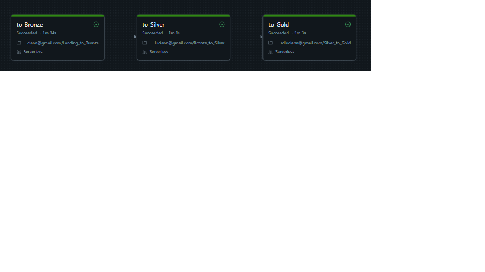

# CineData Analytics: Pipeline de Dados End-to-End

Pipeline de dados em **Databricks (PySpark + SQL)** que estrutura um catálogo de filmes (base combinada TMDB/IMDb) na **Arquitetura Medalhão** (Bronze, Silver e Gold), com modelagem dimensional (Star Schema) pronta para consumo de BI.

Projeto desenvolvido para a Atividade de Engenharia de Dados da RocketLab 2026.2.

---

## Estrutura do repositório

```
├── Landing_to_Bronze.ipynb   # Ingestão dos CSVs e da API do Banco Central
├── Bronze_to_Silver.ipynb    # Limpeza, tipagem, tradução e deduplicação
├── Silver_to_Gold.ipynb      # Star Schema + perguntas de negócio
├── job.yaml                  # Exportação do Databricks Workflow
├── execucao_job.png          # Print da execução com sucesso e dependências
└── README.md
```

## Ordem de execução

| Ordem | Notebook | Task no Job | Depende de |
|---|---|---|---|
| 1 | `Landing_to_Bronze` | `to_Bronze` | (nenhuma) |
| 2 | `Bronze_to_Silver` | `to_Silver` | `to_Bronze` |
| 3 | `Silver_to_Gold` | `to_Gold` | `to_Silver` |

O Job está agendado em **diariamente às 06:00, horário de São Paulo**.

---

## Arquitetura

### Bronze
- Cria o database `bronze` e uma tabela por CSV (`tb_movies_info`, `tb_movies_financials`, `tb_movies_metrics`, `tb_credits_and_tags`, `tb_movies_reviews`), sem alterar estrutura ou conteúdo.
- Adiciona `ingestion_datetime` (timestamp da inserção) em todas as tabelas.
- Grava em **Delta com modo Append**.
- Ingestão via API: cotação do dólar (PTAX, Banco Central) em `bronze.tb_cotacao_dolar`. As datas de início e fim são **widgets** (formato `MM-DD-AAAA`); se vazios, usa os últimos 7 dias corridos a partir da execução.

### Silver
Nomes de colunas em português, tipagem correta e a Bronze nunca é alterada.

| Tabela | Principais tratamentos |
|---|---|
| `tb_info_filmes` | Deduplicação pela ingestão mais recente; normalização e tradução do status (não mapeáveis viram "Não Informado"); conversão de datas em múltiplos formatos; coluna `ano_lancamento` |
| `tb_financeiro_filmes` | Textos de ausência viram NULL; remoção de símbolos e separadores de milhar; zeros e negativos viram NULL; conversão para BRL; lucro e margem percentual sem divisão por zero |
| `tb_metricas_engajamento` | Limpeza da popularidade; conversão segura de tipos (Column Shift vira NULL); notas fora de 0 a 10 e contagens negativas viram NULL |
| `tb_avaliacoes_usuarios` | Remoção de duplicatas exatas; nota fora de 0 a 10 vira NULL; comentário vazio vira "Sem comentário" |
| `tb_generos` | Split + explode com separadores unificados; apenas gêneros válidos |
| `tb_pessoas_empresas` | Dimensão unificada (Ator, Diretor, Roteirista, Produtora), capitalização padronizada e sem duplicatas |
| `tb_cotacao_dolar` | Série temporal contínua com **forward fill** em finais de semana e feriados |

### Gold (Star Schema)
- **Fato:** `fact_movies_performance` (grão: 1 linha por filme lançado).
- **Dimensões:** `dim_movies`, `dim_genres`, `dim_people`, `dim_companies`, `dim_reviews`.
- **Pontes:** `bridge_movie_genre`, `bridge_movie_person`, `bridge_movie_company`.
- Chaves substitutas geradas com `row_number()`. Um `assert` valida que a fato não duplica o grão.

---

## Decisões de negócio

- **Gêneros:** a origem tem Column Shift e mistura países, idiomas, frases e nomes na coluna de gêneros. Por isso só são aceitos os gêneros oficiais do TMDB; qualquer outro texto é descartado.
- **Popularidade:** valores acima de 10.000 são tratados como erro de escala/formatação e viram NULL.
- **Datas ambíguas:** quando um texto serve em mais de um formato, prevalece dia/mês (`d/M/yyyy`). Só vira NULL se nenhum formato converter.
- **Conversão para BRL:** usa a cotação mais recente da série, uma única taxa para toda a base, mantendo os filmes comparáveis.
- **Filmes lançados:** a fato considera apenas `status_filme = 'Lançado'`, pois filmes em produção ou planejados não têm receita nem votos reais.
- **Bronze em Append:** cada execução do Job acumula novas versões dos registros. A Silver deduplica mantendo a ingestão mais recente.
- **Recorte de 2 e 5 anos:** a data limite superior é o lançamento mais recente da base, ignorando datas futuras e filmes não lançados.

---

## Desafio de Analytics

As 6 perguntas de negócio estão respondidas ao final do `Silver_to_Gold.ipynb`, usando `display()`:

1. Receita total (em R$) de todos os filmes
2. Os 5 filmes com maior popularidade
3. Quantidade de filmes por gênero (do maior para o menor)
4. Top 10 filmes por receita (US$ e R$) com `RANK()`
5. Ator com mais participações nos últimos 2 anos
6. Produtora com maior lucro nos últimos 5 anos

---

## Como executar

1. Faça o upload dos 5 CSVs como Volume no Databricks (`/Volumes/workspace/movies/dados_movies/`).
2. Importe os 3 notebooks no workspace.
3. Crie o Job com as 3 tasks e as dependências da tabela acima (ou importe o `job.yaml`).
4. Execute o Job (**Run now**) ou aguarde o agendamento.

## Execução do Job



---

**Autor: Richard Lucian Monteiro de Santanna**
